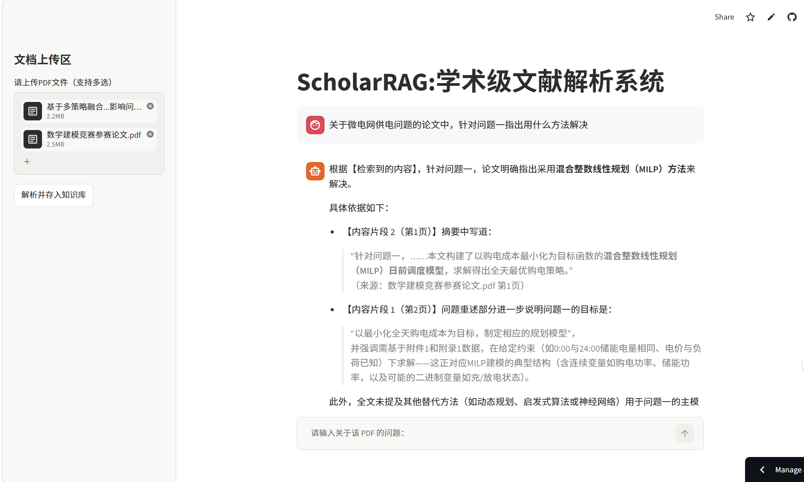

## ScholarRAG：学术级文献解析系统

> 面向 AI4S（AI for Science）科研场景的智能文献阅读与问答系统。
> 致力于解决科研人员在长文献筛选、对比阅读、资料溯源等工作中的痛点，依托RAG检索增强生成技术，基于上传PDF文献做精准问答，降低科研文献阅读成本。

## 核心功能
- **多文档并发解析**：支持多篇PDF论文批量上传、自动文本清洗、分段切片与向量化入库，统一构建文献知识库。
- **精准源头溯源（Source Tracing）**：回答附带原文页码、文本片段锚点，支持跳转定位原文，每一条结论均可溯源查证，满足学术核验需求。
- **抗幻觉安全护栏（Guardrails）**：当知识库检索不到对应文献依据时，系统主动拒绝编造答案，仅告知无相关资料，保障学术严谨性。
- **跨文档知识融合**：支持在多篇文献之间做对比分析、观点汇总、结论提炼，实现多篇文献横向对比阅读。

## 技术架构
- **前端框架**：Streamlit，轻量化Web交互界面，支持一键云端部署，操作简单、无需前端开发基础。
- **大语言模型**：通义千问（DashScope API），承担问答推理、文本总结、多文档对比生成任务。
- **向量数据库**：ChromaDB，实现文档向量持久化存储、相似度检索，快速召回相关文献片段。
- **文档解析引擎**：PyMuPDF（fitz）读取PDF文本，搭配自定义段落合并策略，优化切片逻辑，避免句子被粗暴截断。

## 本地安装与运行指南
1. 克隆本项目并安装依赖：
```bash
pip install -r requirements.txt
2.配置环境变量：
复制.env.example文件，重命名为.env ，填入你的 DashScope API Key；也可以在.streamlit/secrets.toml  内配置：
3.启动应用：
streamlit run full2.py

## 在线体验地址
[点击访问 ScholarRAG 在线演示](Streamlit 公网链接:https://paper-assistant-kjgkgryeqsdhyvcapbdtjz.streamlit.app/)
 
### 项目说明：
本项目为面向科研场景的RAG文献问答系统，区别于通用大模型，回答严格限定在上传的PDF文献内容范围内。
系统对文献进行解析、切片、向量化存储，检索匹配相关片段后再交给大模型生成回答，同时加入溯源机制与防幻觉约束，适配科研学习、论文研读等场景，帮助使用者快速从大量文献中提取有效信息。

### ## 系统演示


### 团队信息：
个人开发者：王淑欣
职业：学生
在读院校：广东工商职业技术大学
